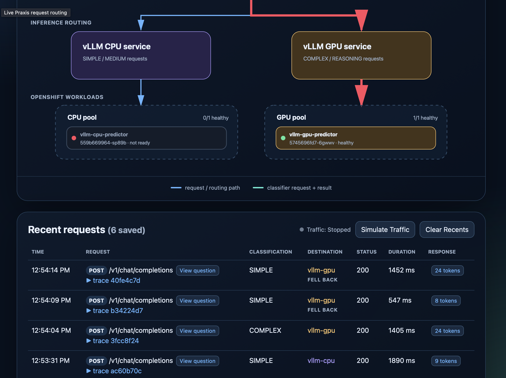

# Praxis & llm-d-sc Demo

## OpenShift stack

The RHOAI overlay deploys Open WebUI, the trace UI, Praxis, `llm-d-sc`, and
CPU and GPU KServe vLLM predictors. Praxis classifies each request and routes
it to the appropriate predictor. On failover, Praxis routes to the other available pool.

### Minimum prerequisites

- `oc` access and `kustomize` as an authenticated OpenShift user with permission to create a namespace.
- RHOAI/KServe installed
- At least one schedulable NVIDIA GPU: the GPU predictor requests one
  `nvidia.com/gpu`.

### Deploy

1. Apply the manifests to the cluster:

   ```bash
   oc apply -k openshift/overlays/rhoai
   oc -n praxis-sr-demo get pods --watch
   ```

2. Model downloads and first GPU scheduling can take several minutes. Press
   `Ctrl-C` once the pods are ready, then retrieve the UI URLs:

   ```bash
   WEBUI_HOST=$(oc -n praxis-sr-demo get route openwebui -o jsonpath='{.spec.host}')
   TRACE_UI_HOST=$(oc -n praxis-sr-demo get route trace-ui -o jsonpath='{.spec.host}')
   echo "Open WebUI: https://${WEBUI_HOST}"
   echo "Trace UI: https://${TRACE_UI_HOST}"
   ```

### Results



